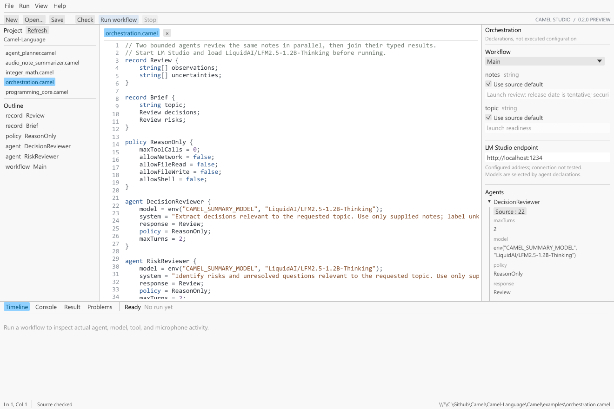

# Camel: From Python Harness Fatigue to Local AI Orchestration


Every local AI prototype seemed to begin with a Python file. Connect to a model. Write a prompt. Ask for JSON. Parse it. Retry when the answer is malformed. Add a tool. Keep the tool call and its result in the conversation history. Put a limit on turns. Add logging. Then make the next prototype—and write most of that harness again.

Python is an excellent language for this work. The frustration came from repetition: every project carried another hand-built layer of prompts, schemas, tool adapters, retries, validation, and orchestration. The application idea might be new; the scaffolding around it usually was not.

Camel began with a question: what if that recurring harness had a language of its own? We wanted programmers to spend less time rebuilding glue, and we wanted programmers and non-programmers alike to have a clearer way into local AI. The goal was to make model use and orchestration readable, guided, and explicit—without hiding what the program actually does.

Democratizing this work does not mean asking people to trust a black box. It means giving a newcomer a small, readable program to start from, a visible place to inspect its parts, and a path to add one idea at a time. Camel Studio and the assistant-guided Issue Triage exercise support that path. The learner still sees code and logic; the language makes those ideas easier to approach.

## The harness became the product

A model call is only the visible center of an agent application. Around it sit decisions that determine whether the application is useful: What shape should the answer have? Which tools may the model ask for? How many turns are allowed? What happens when output is invalid? Can two independent reviews run at the same time? Which result is safe to pass to the next step?

In a collection of small scripts, each answer tends to live in a different place. A prompt lives in a string, a JSON schema in another object, a tool adapter in a callback, and the retry limit in a loop. The logic works—until a change crosses those seams. Then debugging means reconstructing the rules from the harness.

Camel gives those recurring ideas names in source code: **workflows** describe what the program does; **agents** describe model-backed workers; **records** describe structured data; **tools** describe host-provided operations; and **policies** describe limits on model-requested tools. Ordinary programming constructs connect them. The result is a program a reader can inspect from input to final output.

## Why Camel is a language, not a Rust extension

Camel is implemented in Rust, but a Camel program is not a Rust plugin. A Rust extension normally adds functions, macros, or APIs that are compiled as part of a Rust application. Camel has its own source files, grammar, type names, version declaration, import rules, checking behavior, and execution semantics.

The distinction is practical. A `.camel` file can declare records, functions, agents, tools, policies, and workflows without Rust syntax or a Cargo project. The `camel` application loads the source and its imports, lexes and parses them, checks declarations and knowable types, builds an internal program representation, and runs it in the Camel interpreter. The same language rules apply whether the author is using the command line or Camel Studio.

Rust still matters at the extension boundary. A host can register Rust functions as tools for a Camel program to call. That lets an application expose capabilities—file access, an API, or a product-specific operation—while keeping the workflow and agent declarations in Camel source. The host supplies the operation; Camel defines how the program requests, checks, and combines it.

Camel has an explicit `0.2` language edition and a conformance suite of accepted and rejected programs. Those are language-project features: they let the team describe which syntax and behavior an implementation supports and detect when a change breaks that contract. A Rust extension alone would not provide that independent source-level contract.

## A first agent, with boundaries

The simplest useful agent is one that returns a shape the rest of the program can rely on. A read-only issue triager is a good first exercise: it accepts a report, summarizes it, classifies it, and calls out uncertainty. It does not need tools to be useful.

```camel
version "0.2";

record Triage {
    string summary;
    string category;
    string severity;
    string[] nextSteps;
    string[] uncertainties;
}

policy ReadOnly {
    maxToolCalls = 0;
    allowNetwork = false;
    allowFileRead = false;
    allowFileWrite = false;
    allowShell = false;
}

agent IssueTriage {
    model = env("CAMEL_LM_MODEL", "your-loaded-model-id");
    system = "Triage the supplied report using only its facts. List uncertainties; do not invent details.";
    response = Triage;
    policy = ReadOnly;
    maxTurns = 2;
}

workflow Triage Main(string report) {
    AgentResult result = await IssueTriage.run(report);
    return result.data;
}
```

The record gives the model a target shape and gives Camel a contract to validate. The policy makes the example's tool boundary visible. The workflow is still ordinary program logic: it accepts a string, awaits an agent, and returns a typed result.

That progression also became our answer to a first-time user's question: how do you learn what Camel can handle? Begin with one bounded, read-only agent. Inspect its result. Then add one tool, add a second reviewer, import a library, or try larger inputs and retries. Each step tests a new language capability while keeping the source understandable.

## From source to a local run

Install the Camel bundle for your operating system and open a new terminal. Set `CAMEL_LM_MODEL` to a model identifier available in LM Studio, start the LM Studio server, and save the program as `issue-triage.camel`.

For example, in PowerShell:

```powershell
$env:CAMEL_LM_MODEL = "publisher/model"
lms server start
```

Check the source before running it:

```text
camel check issue-triage.camel
```

`check` parses and validates the program without running the workflow, opening the microphone, calling a tool, or contacting a model. Then pass a report to the default `Main` workflow:

```text
camel issue-triage.camel -- "The export button freezes on large projects."
```

Add `--json` before `--` to print the workflow value and captured logs as JSON, or `--trace` to see execution events on stderr.

Camel uses `http://localhost:1234` as its default model endpoint. `CAMEL_LM_ENDPOINT` can point it at another compatible endpoint. The Rust-built CLI can run from a terminal; the native Camel Studio IDE provides a source editor, project and declaration outline, workflow inputs, orchestration details, and result/console panes.



The [installation guide](../../docs/INSTALLATION.md) covers setup, and the [language specification](../../docs/LANGUAGE_SPEC.md) records the precise `0.2` behavior.

## The experiments that shaped Camel

Camel has been exercised as both a general programming language and an agent orchestration language. The experiments have made the scope more concrete—and exposed where the preview still needs evidence.

### Ordinary code should work without a model

The `programming_core.camel` example imports an integer-math module, computes Fibonacci and a sum of squares, returns a typed `Report`, and exercises functions, loops, assertions, exceptions, and tasks. It runs one calculation while another is spawned, then awaits the result. It also awaits the same task twice to check that observing a completed task does not repeat its work.

For the sample input, the offline program returns Fibonacci `8` and sum-of-squares `91`. That matters because Camel is not a prompt wrapper. Its ordinary language core can perform deterministic work without a model server; model calls are one capability inside a larger program.

The same offline example was run from the extracted `0.2.0-preview` distribution as well as the source checkout, checking that the packaged CLI could execute a real Camel program without inference.

### Parallel reviewers return typed data

The `orchestration.camel` example sends the same notes to two bounded agents: one extracts decisions and the other identifies risks. Each returns a `Review` record; the workflow awaits both tasks and joins them into a `Brief`. The policy sets the tool budget to zero and denies network, file, and shell capabilities for model-requested tools.

This experiment connects several pieces at once: named agent declarations, typed model responses, `spawn`/`await`, a shared workflow, and an explicit policy. Deterministic provider tests exercise the request/response boundary, including parallel typed reviewers. They do not prove that a particular live model will reason well or follow its prompt.

### Tools need contracts too

The language also experiments with host operations as declared tools. A tool declaration gives a handler a Camel name, argument types, and return type. The `text.length` handler offers a deliberately small example: a model can request a character count, but the runtime validates the call and routes it through the host's registry.

Policies can allow named tools and set a call budget. The tool batch itself is not a transaction: if one handler succeeds before a later call fails, Camel does not roll back that first effect. Policies constrain model-requested calls; trusted Camel source and host code still require their own safeguards. This is a defined boundary, not an operating-system sandbox.

An older `agent_planner.camel` sketch records an earlier attempt at a planner and email-oriented flow, including reusable agent calls and parallel work. It uses legacy `as` and `Console.Log` syntax that the current edition rejects, so it is a historical experiment rather than a working `0.2` example. Its presence is one reason the current article follows the specification and conformance fixtures instead of treating every old demo as supported behavior.

### Audio became a library experiment

The audio-note example explores a two-stage workflow: capture audio or load a file, ask a transcription agent for spoken text, then ask a summarizer for a topic-focused note. The result uses typed transcript and summary records. The audio agents, prompts, and response shapes now live in the independently versioned `audio` source library; examples demonstrate both a checkout-relative import and an installed-library import.

The runtime's general audio input path and microphone capture have been exercised separately from inference. An early one-second microphone smoke capture succeeded. Automated tests for the current language use injected recorder data. The current code can construct an OpenAI-compatible `input_audio` request, but live LM Studio/Liquid audio inference has not been verified; model availability alone does not establish that a server accepts that payload or sample format.

### Modules, libraries, and Studio broaden the path

The math example demonstrates local module imports. The standard library experiment keeps a small reusable string helper in a separate Camel source file. The library manager adds catalog search and source-library installation, update, and removal; its example syntax imports installed source with an `@camel/...` path. Library versions and source revisions can move independently of the interpreter release.

Studio grew alongside the CLI so users can work in a real editor rather than learning only through terminal commands. A first-time learning path and a larger Release Readiness Desk showcase have also been explored in planning. The Issue Triage sequence above is the smaller, more teachable starting point; the showcase remains a proposal rather than a completed example.

### Conformance turns experiments into a language contract

The `conformance/0.2` fixtures cover positive typed programs and gradual `any` boundaries, alongside programs expected to fail for mismatched assignments, call arguments, conditions, returns, defaults, and unsupported versions. Runtime tests use fake providers and recorders so language behavior can be tested without depending on a live model or microphone.

An early Camel prototype began as a narrow audio host with hard-coded orchestration and source-fragment checks. It proved the first workflow idea and, just as importantly, showed how far that approach was from a language. The general parser, checker, interpreter, and conformance suite replaced the hard-coded path. The project now has a source-level foundation that can grow without baking every new use case into a new harness.

## What Camel can do today

Camel `0.2` combines a general programming core with language-level agent concepts:

- **Values and structure:** integers, doubles, booleans, strings, arrays, objects, and declared records with runtime field validation.
- **Program flow:** typed functions, default arguments, lexical scopes, conditions, loops, returns, exceptions, and source imports.
- **Concurrency:** `spawn` and `await` tasks with copied local state, cached results, shared execution fuel, and a bound on spawned tasks.
- **Agent work:** source-declared model, system prompt, response record, optional tools and policy, bounded turns, retries, and validated `AgentResult` data.
- **Host tools:** typed parameters and return values dispatched through a registered handler, with capability checks and per-agent call limits.
- **Built-ins and input:** logging, environment lookup, JSON, conversions, assertions, ranges, clock access, microphone capture, and audio-file loading.
- **Developer workflow:** versioned `0.2` source, static checks for syntax/names and statically knowable expression types, CLI execution, Camel Studio, and versioned source libraries.

The checker is deliberately gradual. It catches many errors before execution, including known type mismatches, but `any` and dynamic model/host values remain runtime boundaries. It does not prove every control path returns correctly or validate the behavior of a registered host handler.

## Why build Camel in Rust?

Rust is the implementation language for Camel's compiler front end, runtime, CLI, and Studio. It lets the project ship a native executable and use one implementation for parsing, checking, workflow evaluation, execution budgets, typed host calls, and errors. Rust's type system and safe abstractions help make those internal boundaries explicit. Shared Rust crates also let the CLI, Studio, and embedders reuse runtime components.

That choice is about ownership and deployment, not a speed slogan. We have not established a performance benchmark that would justify claiming Camel is faster than Python. Nor does the Rust build compile each `.camel` workflow to native machine code. Rust compiles Camel itself; the current runtime checks a Camel program, represents it internally, and interprets it.

For the person writing an agent, the payoff is simpler: install or build one runtime, write a `.camel` program, check it, and run it. They can see the data contracts, model boundaries, and available tools in the same source they use to control the application.

## A language still becoming itself

Camel is a preview, and the limits are part of its story. Static analysis is partial and `any` is a real gradual boundary. The runtime interprets source; bytecode and native Camel compilation are not implemented. The language does not yet have closures, namespaces, a durable scheduler, general cancellation, or an LSP/debugger. A tool policy does not sandbox arbitrary trusted source, and local-model support depends on the configured server's actual capabilities.

Those limits keep the promise specific. Camel is a language for writing ordinary program logic around local and compatible AI models, with agents, typed responses, tools, policies, tasks, and workflows expressed directly in its source. It grew from the feeling that we were writing the same Python harness again. The answer was to make the harness legible, reusable, and teachable—and then build a language sturdy enough to carry more than one experiment.
